# Proposed Architecture

**Status, October 2026:** Design for the first bounded, playable 2D game. It has not been implemented. The component diagram is the main view; its [editable source](../diagrams/component.mmd) is retained in the repository.

## How it works

The **browser client** (Almadi) accepts a story, shows generation status and versions, and runs approved game data in a fixed 2D runtime. The **platform service** (Aldiyar) owns accounts, projects, immutable versions, jobs and artifact delivery. The **generation worker** (Nurgeldi) maps a story to supported actions and a candidate game specification; an optional external model provides untrusted output. PostgreSQL, RabbitMQ and private artifact storage are proposed supporting components, not installed choices.

An author submits a story → the platform returns project/version/job IDs and `queued` → the worker produces a candidate → the platform independently validates it before publishing an immutable `ready` version → the browser loads that exact version and the player acts toward an ending. The client reads persisted status (`queued`, `generating`, `validating`, `ready` or `failed`); a worker message alone cannot mark a game ready.

## Essential boundaries

- The first game family has bounded scenes and move, inspect, collect, interact and choice actions. Unsupported mechanics need a disclosed, acceptable simplification or a clear failure. A synopsis or valid specification alone is not a playable result.
- A versioned specification defines actions, state changes and an ending. Validation checks schema, references, allowed assets and a bounded path to the goal. A timed-out path search is **unverified** and cannot be published as ready; the path must also work in the browser.
- The runtime interprets approved data and never executes model-generated JavaScript. Artifact delivery rechecks ownership, version and `ready` status. Retries preserve earlier versions; duplicate work must not publish twice. These guarantees still require implementation and tests.

The exact schema, limits, queue recovery method, publication transaction and browser delivery policy remain open design decisions. The [project plan](project-plan.md) identifies the checks needed before any of these behaviors can be claimed.

For boundaries and acceptance detail, see the [scope and contract draft](decisions/scope-and-contract.md), [requirements](requirements.md) and [technology comparison](technology-comparison.md). The [system context](../diagrams/system-context.svg) and [use-case view](../diagrams/use-case.svg) provide the two other required diagrams; the [static prototype](../prototype/README.md) shows the intended author flow.
